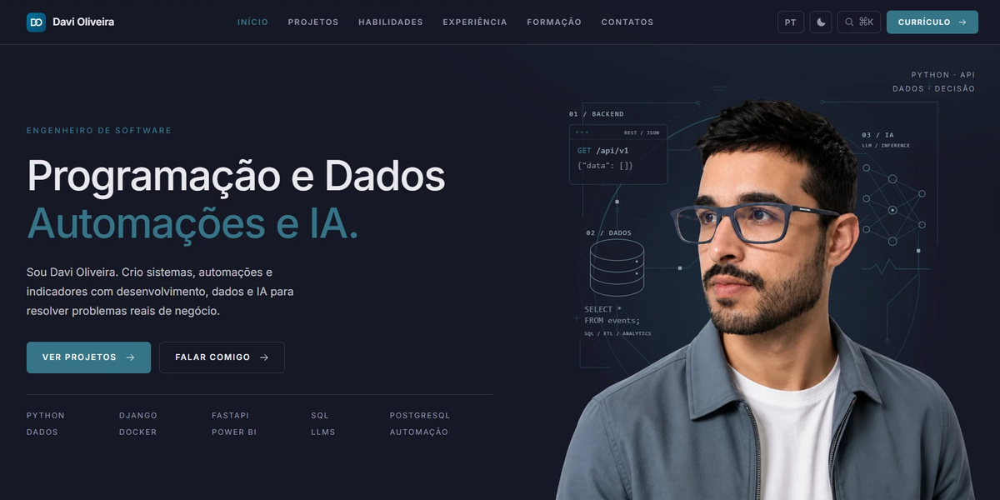

# Portfólio - Davi Oliveira

[](https://github.com/davioliveiraes/portfolio_davi_oliveira/actions/workflows/ci.yml)



Portfólio profissional desenvolvido com Django, apresentando projetos, competências, experiências e formação de um Desenvolvedor Backend Python.

Acesse: [davioliveira.tech](https://davioliveira.tech)

---

## Finalidade

Construir um portfólio pessoal completo e funcional, desde o desenvolvimento até o deploy em produção, aplicando boas práticas de engenharia de software em todas as etapas do projeto.

---

## Tecnologias Utilizadas

- **Backend:** Python, Django
- **Frontend:** HTML5, CSS3, JavaScript
- **Banco de Dados:** PostgreSQL em produção, SQLite no desenvolvimento
- **Servidor:** Gunicorn, Nginx
- **Infraestrutura:** VPS Hostinger (Ubuntu 24.04), SSL com Let's Encrypt
- **Qualidade:** Pytest, Black, isort, Pre-commit, GitHub Actions
- **Versionamento:** Git, GitHub

---

## Como rodar localmente

Requer Python 3.12.

```bash
python -m venv venv
venv/bin/pip install -r requirements-dev.txt   # Windows: venv\Scripts\pip
cp .env.example .env                           # preencha SECRET_KEY e DEBUG=True
venv/bin/python manage.py migrate              # cria o banco e carrega o conteúdo
make run                                       # http://localhost:8000
```

O conteúdo do site (projetos, experiências, habilidades e certificações) fica no banco e é editável pelo `/admin/`. As migrações de dados em `apps/core/migrations/` mantêm desenvolvimento e produção com o mesmo conteúdo.

---

## Testes e qualidade

```bash
make test    # suíte de testes
make cov     # testes com relatório de cobertura
make lint    # black + isort, como no CI
```

O CI roda formatação, checagem de migrações pendentes e a suíte de testes a cada push e pull request.

---

## Deploy

`make deploy` verifica o repositório local, envia o branch para o GitHub e atualiza a VPS via SSH (`git pull`, dependências, migrações, `collectstatic` e restart do serviço com healthcheck). A configuração da VPS fica em `deploy/deploy.conf`, fora do git (modelo em `deploy/deploy.conf.example`).

---

## Conceitos Aprendidos

- Arquitetura de projetos Django com separação em apps
- Configuração de ambientes de desenvolvimento e produção
- Internacionalização (PT/EN) com conteúdo traduzido no banco
- Formulários com validação via ModelForm e honeypot contra spam
- Envio de emails com SMTP (Gmail)
- Deploy completo em VPS com Gunicorn + Nginx + systemd
- Configuração de SSL/TLS com Certbot
- Serviço de arquivos estáticos com WhiteNoise
- SEO técnico: sitemap com hreflang, URL canônica e Open Graph
- Testes automatizados com Pytest e integração contínua com GitHub Actions
- Pre-commit hooks para padronização de código

---

## Referências

- [AckerCode](https://www.ackercode.com/)
- [Pabloaa](https://www.pabloaa.com/)
